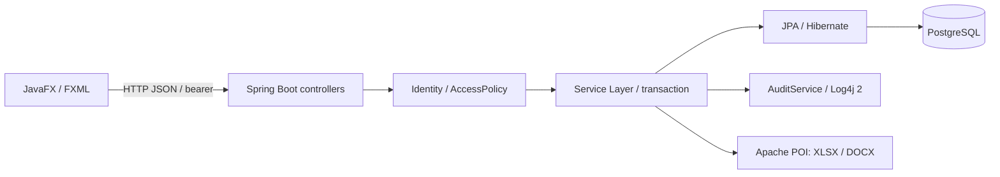

# Архитектура и покрытие требований

Нормативная основа — [TZ.md](TZ.md); декомпозиция — [REQUIREMENTS.md](REQUIREMENTS.md), реализация и приёмка — [ROADMAP.md](ROADMAP.md). Здесь описана фактическая система, а не новый источник требований. `[x]` в requirements/roadmap не означает завершённую сквозную приёмку.

## Стек, требуемый ТЗ

| ТЗ | Выбор реализации | Где применяется |
|---|---|---|
| Java | Java 21 | Оба Maven-модуля; версия 21 — уточнение U-02 |
| JavaFX, FXML / Scene Builder | JavaFX 21.0.10, FXML, native Controls/Canvas/Chart | `frontend`, welcome и кабинет; Scene Builder не runtime-зависимость |
| Spring Boot, Service Layer | Spring Boot 3.5.16, сервисы бизнес-операций | `backend` |
| Spring Data JPA / Hibernate | JpaRepository, EntityManager, Hibernate | Сущности, запросы, транзакции |
| PostgreSQL или MySQL; PostgreSQL Docker (§4) | PostgreSQL 16 в Docker | Постоянные университетские данные |
| Валидация, исключения, транзакции | Сервисные проверки, BusinessException/ApiErrors, `@Transactional`, ограничения БД | Операции CRUD и журналов |
| Log4j 2 | `app.log`, `error.log`, аудит в файле и БД | `log4j2-spring.xml`, audit |
| Apache POI, XLSX/DOCX | poi-ooxml 5.4.1 | `ReportService` |
| JUnit, минимум 25 тестов | JUnit Jupiter | Бизнес-правила и регрессии |
| Git, README | Репозиторий и корневой README | История и инструкция запуска |

Версии, REST, способ хранения токена, дополнительные библиотеки и инфраструктурные инструменты не предписаны самим ТЗ. Они не добавляют обязательных технологий в таблицу выше.

## Дополнительные решения для требований и уточнений

| Решение, не указанное буквально в ТЗ | Назначение и основание |
|---|---|
| Maven Wrapper, Maven, Docker Compose, Dockerfile, Adminer | Сборка/запуск двух модулей и контейнеров; U-01, U-02 |
| HTTP REST, JDK HttpClient, Jackson | Связь native GUI с отдельным API; NFR-02, U-01 |
| Spring Security, BCrypt, случайные bearer tokens | Реализация FR-01; это не OAuth/JWT-требование ТЗ |
| Flyway, PostgreSQL JDBC, `btree_gist` | Миграция, соединение и ограничения конфликтов; NFR-03–NFR-05, FR-07 |
| Mockito, MockMvc, Testcontainers | Проверки сервисов, настоящей HTTP security цепочки и PostgreSQL; NFR-08, U-05 |
| Python 3 и curl | Проверка правильного API/порта и launch-тесты; U-02, U-05 |
| Manrope, IBM Plex Mono, Inter с OFL-лицензиями | Ресурсы визуального прототипа; U-03 |

Bootstrap/HTML из `prototype` не используются как runtime GUI. MySQL, React, WebView и облачные платформы не являются выбранными компонентами системы.

## Структура репозитория

```text
.
├── pom.xml, mvnw, mvnw.cmd             # Maven reactor и wrapper
├── compose.yml, .env.example           # PostgreSQL + API + Adminer
├── frontend/
│   ├── pom.xml
│   └── src/
│       ├── main/java/edu/tou/
│       │   ├── DesktopApplication.java
│       │   ├── welcome/                # Авторизация и история welcome
│       │   ├── identity/, profile/     # Пользователи и собственный профиль
│       │   ├── students/, teachers/, groups/
│       │   ├── curriculum/, schedule/
│       │   ├── attendance/, grades/
│       │   ├── dashboard/, reports/
│       │   ├── supervision/, audit/
│       │   └── workspace/, shared/     # Главное окно, общие таблицы/формы/API
│       ├── main/resources/edu/tou/     # welcome.fxml, CSS, bundled fonts
│       └── test/java/edu/tou/          # Unit/contract и WelcomeE2EIT
├── backend/
│   ├── pom.xml, Dockerfile
│   └── src/
│       ├── main/java/edu/tou/
│       │   ├── ApiApplication.java
│       │   ├── identity/               # Вход, профиль, роли, сеансы, RBAC
│       │   ├── students/, teachers/, groups/
│       │   ├── curriculum/, schedule/
│       │   ├── attendance/, grades/
│       │   ├── dashboard/, reports/, supervision/, audit/
│       │   ├── university/             # Общий RecordsController/UniversityService
│       │   └── bootstrap/, shared/     # DemoSeeder, каталог, ошибки, базовая запись
│       ├── main/resources/
│       │   ├── application.yml, log4j2-spring.xml
│       │   └── db/migration/V1__schema.sql
│       └── test/java/edu/tou/          # Доменные/HTTP тесты и PostgresApiIT
├── scripts/                           # Запуск, сборка, unit/E2E, API preflight
├── prototype/                         # Неизменённые HTML-референсы
├── docs/
│   ├── TZ.md                          # Источник истины
│   ├── REQUIREMENTS.md                      # FR/NFR/UC и отдельно U-уточнения
│   ├── ROADMAP.md                     # Фазы, milestones, чеклисты
│   ├── ARCHITECTURE.md                # Структура, технологии, покрытие
│   ├── RBAC.md                        # Роли и матрица прав
│   ├── schema.dbml                    # Отображение фактической SQL-схемы
│   └── AUDIT.md                       # Результаты и ограничения приёмки
├── README.md                          # Быстрый запуск и карта документации
└── CHANGELOG.md                       # Чеклист важных изменений/верификации
```

Package-by-feature используется в обоих модулях. В текущей реализации сущности и репозитории разделены по доменам, но часть CRUD/binding/DTO/валидации сосредоточена в `UniversityService`, а таблицы и формы переиспользуются из `workspace`. Полная изоляция сервисов каждого домена пока не достигнута; это ограничение, а не заявленное полное соответствие U-01.

## Поток операции



GUI не подключается к PostgreSQL напрямую. Сервер проверяет доступ при чтении и перед/после связывания изменяемых данных. Конфликт расписания проверяется сервисом и PostgreSQL exclusion constraints; `version` обеспечивает контроль конкурентного изменения. Ошибка транзакционной операции должна откатывать её данные.

Вход: выбранная роль и снимок формы → `/api/auth/login` → BCrypt → случайный токен; в БД хранится SHA-256 токена, срок 8 часов. Новый вход не отправляет предыдущий токен. Выход удаляет сеанс; смена пароля/изменение аккаунта отзывает сеансы. Это выбранный механизм реализации FR-01/FR-11, не отдельное требование ТЗ.

Host API: 18080 по умолчанию, общий `API_PORT` для Compose и GUI; контейнер слушает 8080. `docker-up.sh` ждёт `application=tomorrow-tou, status=UP`; UP появляется после инициализации. `frontend.sh` отклоняет другой/старый сервер. Adminer: 8081; PostgreSQL: 5432. Инструкции и переменные — в [README](../README.md).

## Права доступа

Матрица ролей и области доступа вынесены в [RBAC.md](RBAC.md).

## Модель данных и DBML

[Schema DBML](schema.dbml) отражает [Flyway V1](../backend/src/main/resources/db/migration/V1__schema.sql). Миграция — исполняемый источник фактической структуры БД; DBML — её документация, не замена миграции и не самостоятельный источник продуктовых требований.

10 обязательных сущностей ТЗ отображены: User → app_user, Group → study_group (`StudyGroup` в Java); Student, Teacher, Subject, Lesson, Attendance, Grade, Semester, Room → одноимённые таблицы в snake_case. Три дополнительные сущности обеспечивают реализацию: access_session (вход), audit_event (аудит), lesson_review (U-04). Две таблицы связей teacher_subject/group_subject реализуют N:M и не считаются дополнительными бизнес-сущностями.

Ограничения: FK/NOT NULL/UNIQUE/CHECK; уникальная отметка student+lesson и оценка student+lesson+type; регистронезависимые уникальные email; `version`; GiST-пересечения преподавателя, аудитории и группы. Конфликт группы — дополнительное защитное правило реализации FR-07, не буквальное требование ТЗ. Семантика PostgreSQL CHECK/EXCLUDE и функциональных индексов описана в notes DBML и остаётся в SQL.

## Сквозная трассировка требований

Колонка «проверка» показывает конкретное свидетельство/сценарий; подготовленный IT не считается выполненным. Текущие результаты и ограничения — только в [AUDIT.md](AUDIT.md).

| Требование | Домен / файлы реализации | Проверка / критерий | Milestone |
|---|---|---|---|
| FR-01 | identity; WelcomeController → IdentityController/IdentityService/SecurityConfiguration | IdentityServiceTest, AuthenticationFlowTest; WelcomeE2EIT для всех ролей | M2 |
| FR-02 | DashboardService, DashboardView | PostgresApiIT; изменение данных → изменение KPI/диаграмм | M5 |
| FR-03 | StudentsFeature, Student, RecordsView/EntityDialog, UniversityService | UniversityServiceTest, FeatureContractsTest; CRUD через GUI/БД | M3 |
| FR-04 | TeachersFeature, Teacher, DTO/card в UniversityService/RecordsView | AccessPolicyTest; назначенные дисциплины, расписание, нагрузка | M3 |
| FR-05 | GroupsFeature, StudyGroup, group_subject | UniversityServiceTest; карточка состава/куратора/учебного плана | M3 |
| FR-06 | ScheduleView, LessonsFeature, Lesson | PostgresApiIT; сопоставление календаря/таблицы | M4 |
| FR-07 | ScheduleRules, UniversityService, SQL exclusions | ScheduleRulesTest; реальные PostgreSQL конфликты в PostgresApiIT | M4 |
| FR-08 | AttendanceView/Feature, Attendance, markAll | UniversityServiceTest; сохранение отметок через API/GUI | M4 |
| FR-09 | GradesView/Feature, GradeRules, DTO средних | GradeRulesTest; API/БД и пересчёт студента/группы/предмета | M4 |
| FR-10 | ReportsView, ReportController/ReportService | ReportServiceTest, export PostgresApiIT; открыть XLSX/DOCX и сверить данные | M5 |
| FR-11 | ProfileView, IdentityService.profile/logout | IdentityServiceTest, AuthenticationFlowTest, WelcomeE2EIT | M2 |
| FR-12 | RecordsView: FilteredList/SortedList/страницы | Проверка поиска, фильтров, сортировки и страниц через GUI | M3 |
| FR-13 | FieldSpec/EntityDialog, BusinessException/ApiErrors, service validate | UniversityServiceTest; ошибочный ввод и Alert/Dialog | M3, M4 |
| FR-14 | Ui.confirm, RecordsView, ScheduleView, AttendanceView | Отмена подтверждения не меняет БД; native UI приёмка | M3, M4 |
| FR-15 | Workspace.canWrite/canEdit/canDelete, RecordsView | AccessPolicyTest, UniversityServiceTest; разрешённые действия форм | M3, M4 |
| FR-16 | AccessPolicy, UniversityService, ReportService | AccessPolicyTest, PostgresApiIT: list/get/export чужих оценок | M4, M5 |
| FR-17 | Teacher.subjects, AccessPolicy.read(Subject) | AccessPolicyTest; назначенные subjects | M3 |
| FR-18 | Workspace и role navigation | WelcomeE2EIT; обход всех доступных экранов при приёмке | M2, M6 |
| NFR-01 | DesktopApplication, welcome.fxml, native controls | Компиляция/FXML contract; runtime JavaFX и визуальная приёмка | M1, M2 |
| NFR-02 | backend pom, сервисы, JpaRepository/EntityManager | Core service tests; полный API/ORM запуск | M1 |
| NFR-03 | compose.yml, V1__schema.sql | Compose config; настоящий старт PostgreSQL и сохранение volume | M1 |
| NFR-04 | 13 entities, 15 tables, schema.dbml | ModelMappingTest; SQL/DBML сверка и PostgresApiIT | M1 |
| NFR-05 | @Transactional, service checks, @Version, SQL constraints | Unit-запреты, PostgreSQL rollback/conflict приёмка | M1, M4 |
| NFR-06 | AuditService, log4j2-spring.xml | Проверить app/error/audit после действий и ошибки | M2, M5 |
| NFR-07 | backend pom, Apache POI ReportService | Шесть ReportServiceTest и чтение реальных документов | M5 |
| NFR-08 | backend/frontend test, Maven test/IT profiles | JUnit-прогоны; единый scripts/e2e-test.sh | M6 |
| NFR-09 | README, git history | Три реальных коммита; полнота этапной истории не подтверждена | M6 |
| NFR-10 | 10 экранов, app.css, Dashboard charts/KPI | Компиляция; визуальная и функциональная приёмка всех экранов | M2, M5, M6 |
| NFR-11 | GUI actions; scripts только для разработчика | UC выполняются через JavaFX, без консольных бизнес-операций | M1, M6 |
| UC-01, UC-10 | identity/profile/welcome | Вход → профиль → выход → запрет старого токена | M2 |
| UC-02, UC-09 | dashboard/reports | Изменение журналов → аналитика → реальный документ | M5 |
| UC-03, UC-04, UC-05 | students/teachers/groups/workspace | Справочник → поиск → связанная карточка → разрешённый CRUD | M3 |
| UC-06, UC-07, UC-08 | schedule/attendance/grades | Занятие → журнал → оценка/средние, права и конфликты | M4 |
| U-01, U-02 | Два модуля, feature packages, scripts/Compose | Структура и запуск; UniversityService остаётся общим оркестратором | M1 |
| U-03 | WelcomeController, AttendanceNarrative, bundled fonts | Font/narrative tests; визуальное сравнение 1:1 пока открыто | M2 |
| U-04 | LessonReview, SupervisionView, AccessPolicy | Создание проверки сотрудником и запрет чужого изменения | M5 |
| U-05 | AuthenticationFlowTest, PostgresApiIT, WelcomeE2EIT | Unit/HTTP выполнены; полный E2E и пользовательский сбой не подтверждены | M2, M6 |
